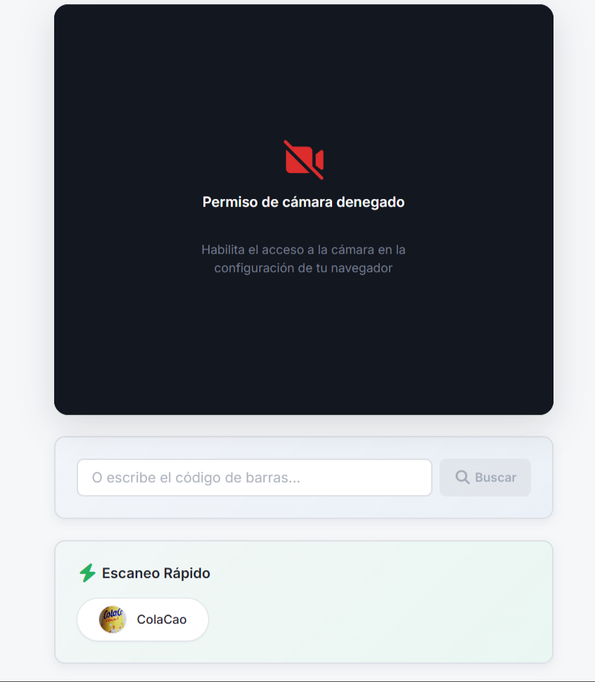
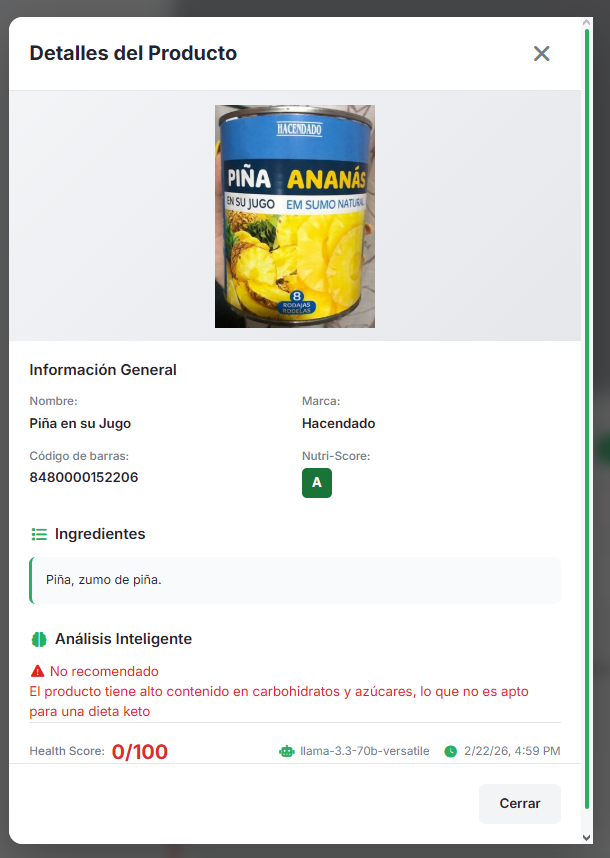
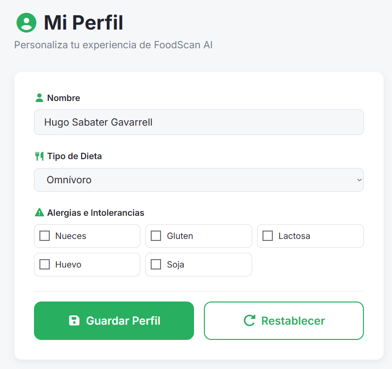

# 🥗 FoodScan AI - Asistente Nutricional Inteligente


> **FoodScan AI** transforma tu móvil en un nutricionista de bolsillo. Escanea códigos de barras y recibe un análisis instantáneo basado en tu perfil único (Alergias, Dietas: Vegano, Keto, etc.) potenciado por Inteligencia Artificial.

---

## 🚀 Demo en Vivo

👉 **[Ver Proyecto Desplegado](https://foodscan-ai-nine.vercel.app/)**

---

## 📸 Capturas de Pantalla

| Escáner Inteligente | Análisis IA | Perfil de Salud |
|:---:|:---:|:---:|
|  |  |  |

---

## 🛠️ Arquitectura y Stack

Este proyecto sigue una arquitectura **Clean Code** con separación estricta de responsabilidades:

### 🎨 Frontend (Desplegado en Vercel)
* **Framework:** Angular 17+ (Standalone Components, Signals).
* **Estilos:** SCSS Modular con metodología **BEM**.
* **Diseño:** Glassmorphism, animaciones CSS nativas y diseño 100% Responsive.
* **Características:** Escaneo visual (ZXing), Modo manual, PWA Ready.

### ⚙️ Backend (API REST en Railway)
* **Runtime & Despliegue:** Node.js + Express alojado en **Railway**.
* **Base de Datos:** MySQL en la nube (Gestionada con Sequelize ORM).
* **IA & Rendimiento:** Llama-3-70b (vía Groq SDK) con sistema de **Caché Global** (`AnalysisResult`) para evitar peticiones redundantes y latencia.
* **Calidad:** ESLint, Prettier, Morgan (Logs), Helmet (Seguridad) y validación de variables de entorno.

---

## 📂 Estructura del Proyecto

```
FoodScan-AI/
├── backend/                # 🔧 API REST (Node.js + Express)
│   ├── src/
│   │   ├── controllers/    # Lógica de negocio
│   │   ├── services/       # IA (Groq) + OpenFoodFacts
│   │   ├── models/         # Sequelize ORM
│   │   └── routes/         # Express routes
│   ├── package.json
│   └── .env.example
│
├── frontend/               # 🎨 SPA (Angular 17)
│   ├── src/
│   │   ├── app/features/   # Scanner, History, Profile
│   │   ├── app/shared/     # Componentes reutilizables
│   │   └── styles/         # SCSS con BEM
│   ├── package.json
│   └── vercel.json
│
├── docs/                   # 📚 Documentación
│   ├── IA_WORKLOG.md       # Diario de desarrollo con IA
│   ├── DOCKER_DEPLOYMENT.md # Documentación de despliegue con Docker
│   ├── INFORME_AUDITORIA_FINAL.md # Informe basado en los criterios, realizada por la IA
│   └── assets/             # Screenshots
│
├── LICENSE                 # MIT License
├── SECURITY.md             # Política de seguridad
└── README.md               # Este archivo
```

---

## 🚀 Instalación y Despliegue

Puedes ejecutar FoodScan AI de dos maneras: la recomendada (Docker) para un despliegue rápido, o la manual para desarrollo.

### Opción A: Docker (Recomendado 🐳)

Ideal para evaluar el proyecto sin configurar entornos locales.

1. **Prerrequisitos**: Docker y Docker Compose instalados.
2. **Configurar variables**:
   ```bash
   cp .env.docker.example .env
   # Edita .env y añade tu GROQ_API_KEY
   ```
3. **Levantar el stack**:
   ```bash
   docker-compose up -d --build
   ```
4. **Cargar datos demo**:
   ```bash
   docker-compose exec backend npm run seed
   ```
5. **Acceso**:
   - **Frontend**: http://localhost (o puerto 8080 según config)
   - **Backend**: http://localhost:3000
   - **Adminer**: http://localhost:8888 (Gestión DB)

---

### Opción B: Instalación Manual

Para desarrollo activo y depuración.

1. **Requisitos**: Node.js v18+ y MySQL Server.
2. **Configurar Backend**:
   ```bash
   cd backend
   cp .env.example .env # Configura tus credenciales locales
   ```
   ```bash
   npm install
   npm run seed
   npm run dev
   ```
3. **Configurar Frontend**:
   ```bash
   cd ../frontend
   npm install
   npm start
   ```
4. **Acceso**: http://localhost:4200

---

## 🤖 Diario de Desarrollo con IA

El desarrollo de este proyecto ha sido asistido por IA actuando como "Senior Architect".
Puedes consultar el registro completo de prompts, decisiones de arquitectura y resolución de problemas en:

📄 **[Ver Diario de IA](./docs/IA_WORKLOG.md)**

---

## 🎯 Características Destacadas

* ✅ **Escaneo en Tiempo Real:** Detección automática de códigos de barras con ZXing
* ✅ **Análisis IA:** Llama-3-70b analiza ingredientes contra tu perfil
* ✅ **Búsqueda Manual:** Input alternativo para códigos sin cámara
* ✅ **Historial Persistente:** Todos tus escaneos guardados en MySQL
* ✅ **Responsive Design:** Optimizado para móvil y desktop
* ✅ **Arquitectura BEM:** CSS modular y mantenible

---

## 🧪 Pruebas de Concepto (Demo)

### Caso Vegano:
* Ve a Perfil, selecciona "Vegano".
* Escanea "Nutella" (código: `3017620422003`).
* Resultado: 🔴 **No Apto** (Contiene Leche).

### Caso Omnívoro:
* Ve a Perfil, selecciona "Omnívoro".
* Escanea "Nutella".
* Resultado: 🟡 **Apto con Reservas** (Score nutricional bajo, pero compatible).

---

## 🗺️ Roadmap y Trabajo Futuro (Versión 2.0)

El desarrollo de FoodScan AI es un proyecto vivo. Actualmente se está trabajando en una rama paralela (`feature/v2-redesign`) proyectada para el próximo mes, que incluirá un rediseño completo y nuevas funcionalidades core.

**Novedades planificadas para la V2:**
* 🎨 **Nueva Interfaz UI/UX (Stitch):** Rediseño integral de la plataforma hacia un modelo de "Dashboard" más analítico, moderno y estructurado.
* 🔐 **Sistema de Autenticación:** Módulo de Login/Registro seguro para que los usuarios puedan mantener su perfil y sincronizar su historial en múltiples dispositivos.
* ❤️ **Favoritos y Comparador:** Nueva sección para guardar productos recurrentes y una herramienta para comparar macros y alérgenos de dos productos frente a frente.
* 📈 **Analíticas Avanzadas (Health & Habits):** Gráficos evolutivos del progreso nutricional mensual y seguimiento de macronutrientes en base al perfil biométrico del usuario.

---

## 👤 Autor

**Hugo Sabater**
* [GitHub Profile](https://github.com/HugoSabater)
* Proyecto realizado como TFG para Desarrollo de Aplicaciones Web (DAW).

---

## 📄 Licencia

Este proyecto está bajo la licencia [MIT](LICENSE).

---

**¿Preguntas o sugerencias?** Abre un [issue](https://github.com/HugoSabater/FoodScan-AI/issues) en GitHub.
